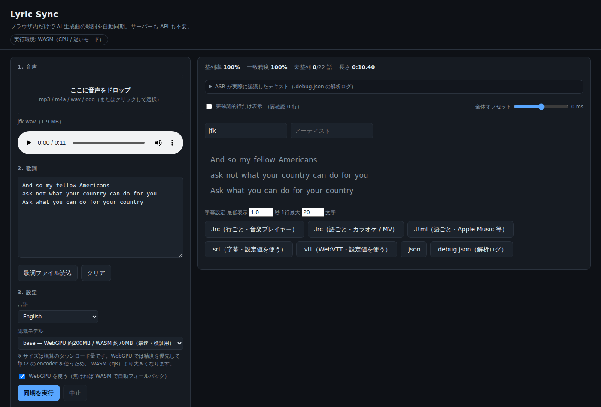
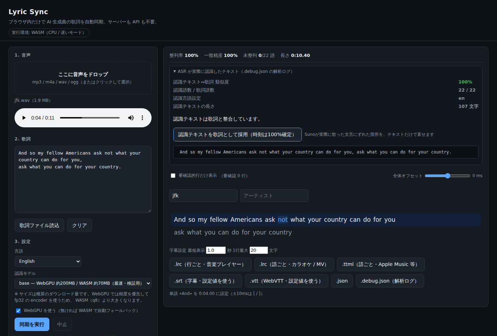

# Suno Lyric Sync

**ブラウザだけで完結する歌詞同期ツール。** AI 生成音楽（Suno など）の音声と歌詞テキストから
各単語の再生時刻を推定し、MV 制作で使える字幕・歌詞ファイルを書き出します。

サーバー不要・アカウント不要・API キー不要・無料。
**音声ファイルがブラウザの外に出ることはありません**（モデルの初回ダウンロードのみ通信）。



---

## 特徴

- **完全ローカル実行** — 音声認識はブラウザ内（WebGPU / WASM）で完結。API キー不要、外部サーバー不要
- **forced alignment** — 歌詞が既知なので「認識」ではなく「時刻への整列」。聞き間違いは時刻側から捨てられ、テキストはそのまま保たれる
- **7 形式の書き出し** — `.lrc` / `.lrc`（語ごと）/ `.ttml` / `.srt` / `.vtt` / `.json` / `.debug.json`
- **手動補正の UI** — 単語をクリックするだけで再生ヘッド時刻に合わせられる（±10ms / ±50ms）
- **整列率・一致精度の表示** — 自動で仕上げ不值得な箇所が一目でわかる
- **MV 向けの字幕設定** — 最低表示時間・1行最大文字数を指定して `.srt` / `.vtt` を出力

## 実測データ

3分20秒の日本語ボーカル曲（WebGPU 環境）での実測値です。

| モデル | 解析時間 | 整列率 | 一致精度 | 未整列 |
| --- | --- | --- | --- | --- |
| `small` | 98.5秒（RTF 0.51） | 86.5% | 98.2% | 44 語 |
| **`medium`（既定）** | 145.4秒（RTF 0.75） | **96.0%** | 98.7% | **13 語** |

`small` で未整列だった 44 語のうち **15 語を救い、1 語も壊しませんでした**。
残る未整列（同音異字・表記違い）は「認識テキストを歌詞として採用」機能を使えば
文字列の修正だけで済みます（時刻は再計算不要）。

再現方法: `node test/diff-models.mjs`

## 使い方

```bash
npm install
npm run dev        # http://127.0.0.1:5173 を開く
```

1. 音声（mp3 / m4a / wav / ogg）をドロップ
2. 歌詞テキストを貼り付け（`[Verse]` 等のセクションタグは保持されます）
3. 言語と認識モデルを選んで「同期を実行」
4. 再生しながらズレを修正（単語をクリック → 再生ヘッド時刻に設定）
5. 必要なフォーマットで書き出し

**MV 制作での使い方は [`MANUAL.md`](./MANUAL.md)** に、DaVinci Resolve / Premiere Pro /
After Effects / YouTube への具体的な取り込み手順を含めてまとめています。



## 動作原理

```
音声 ──Web Audio──> 16kHz モノラル PCM
                          │
        Whisper (ONNX) return_timestamps:'word'
        「認識した単語 + 時刻」を取得
                          │
        Needleman-Wunsch で「手元の歌詞トークン」と整列
        （聞き間違いは時刻側を捨てる / 未整列語は前後から補間）
                          │
        行・単語タイムスタンプ → LRC / TTML / SRT / VTT / JSON
```

歌詞が既に分かっているため、これは **forced alignment** です。
Whisper が聞き間違えた語は認識側で捨てられ、時刻だけが採用されます。

### 日本語で特に很重要的 2 つの処理

1. **CJK の粒度合わせ** — Whisper の日本語出力は「深」「夜」「じ」のように**1文字単位**ですが、
   歌詞は「深夜」「全部」の単語単位です。この粒度差は1対1整列では吸収できないため、
   両側を1文字に展開してから整列し、元の語に戻して集計しています（実測 83.2% → 86.5%）。
2. **DTW 退化出力の補正** — Whisper は連続する語を同一時刻に潰したり（例: 6語がすべて 72.96-72.96）、
   イントロの間奏を1語に吸収したり（例: 最初の語が 0.00-14.26s）します。どちらも自動補正しています。

## 対応モデル

| key | モデル | サイズ | 用途 |
| --- | --- | --- | --- |
| `base` | `onnx-community/whisper-base_timestamped` | ~150MB | 最速・検証用 |
| `small` | `onnx-community/whisper-small_timestamped` | ~250MB | 速さ重視 |
| `medium` | `onnx-community/whisper-medium_timestamped` | ~800MB | **既定（推奨）** |
| `turbo` | `onnx-community/whisper-large-v3-turbo_timestamped` | ~700MB〜 | 最良 |

多言語対応（日 / 韓 / 英 / 中 など）。言語は自動判定より**明示指定のほうが正確**です
（歌唱音声では自動判定が失敗しやすいため）。

## デモ（GitHub Pages）

https://raika-rei-lab.github.io/lyric-sync/

ブラウザだけで動作し、サーバーも API キーも不要です。初回のみモデルの
ダウンロード（150〜800MB）に時間がかかります。

ローカルで Pages 相当の挙動を再現する場合:

```bash
npm run build -- --base=/lyric-sync/
npm run test:pages    # dist/ を /lyric-sync/ にマウントした静的サーバで実ブラウザ検証
```

## 動作環境

| | |
| --- | --- |
| ブラウザ | Chromium 系（Chrome / Edge / Brave）。WebGPU 対応なら大幅高速 |
| Firefox | 動作はするが WebGPU 非対応のため WASM 実行（低速） |
| Safari | **未検証**（WebGPU の実装状況により動作が異なる可能性があります） |
| モバイル | **非推奨**（メモリ・処理時間のため） |
| Node.js | 20 以上（開発・CLI 実行用） |

GPU なしの環境（WASM）では 3分の曲子に 5〜10 分かかります。

## 制限と既知の注意

- **手動補正前提。** 歌唱声は ASR が弱く、既存ツールの実績でも単語の 5〜15% は数百 ms の調整が必要です。
  UI の単語クリック＋`[`/`]`（Shift で 50ms）で直します。
- **完全自動で「一切触らない」は目指していません。** 整列率と一致精度を画面に出し、低ければ警告します。
- `chunk_length_s` は **29 固定**。30 にすると時刻が壊れます（transformers.js #1357）。
- WebGPU では 1曲ごとにパイプラインを破棄して作り直します（メモリリーク回避、transformers.js #1739）。
- ボーカル分離（Demucs など）は入れていません。伴奏が声を埋もれる場面では精度が落ちます。
- 漢字とかなの書き分け（`解いて` / `ほどいて`）は自動整列できません。

## プライバシー

- **音声ファイルと歌詞テキストは、ブラウザの外に送信されません。**
- 通信するのは **Hugging Face からのモデル重みのダウンロードのみ**です（初回のみ、以降ブラウザにキャッシュ）。
- 設定・解析結果の保存先はどこにもありません（ブラウザを閉じると消えます）。
- 本ツールはトラッキング・広告・解析 SDK を一切使用していません。

## 開発

```bash
npm run dev          # 開発サーバー
npm run build        # 本番ビルド
npm run preview      # ビルド結果の確認

npm run test:unit        # 整列・書き出しロジック（即時、モデル不要）
npm run test:e2e         # Playwright でブラウザ実操作（本番ビルドを preview 起動）
node test/asr-node.mjs   # Node で実際にWhisperを走らせる
npm run test:pages     # GitHub Pages 相当（/lyric-sync/）での実ブラウザ検証
node test/exp-align.mjs  # .debug.json fixture で整列アルゴリズムの効果を比較
node test/diff-models.mjs # 2つの .debug.json（別モデル）を単語レベルで比較
```

CLI で成果物を一括生成:

```bash
# 認識テキストをそのまま歌詞として使う場合（整列率100%）
node scripts/regen-lrc.mjs 曲名.debug.json out/

# 元の歌詞テキストで最終成果物一式 + 要確認リストを作る場合
node scripts/finalize.mjs 曲名.debug.json 歌詞.txt out/

# 字幕の折り返し幅と最低表示時間を指定
SRT_MAX=14 SRT_MIN=1.2 node scripts/finalize.mjs 曲名.debug.json 歌詞.txt out/
```

### 設計メモ

| ファイル | 役割 |
| --- | --- |
| `src/text.js` | 正規化・トークン分割（英単語 / 日本語 Intl.Segmenter / 韓国語） |
| `src/asr-core.js` | Whisper 実行と後処理（巨大スパン・退化スパンの補正） |
| `src/asr-worker.js` / `src/asr.js` | Web Worker 実行、WebGPU→WASM フォールバック、音声デコード |
| `src/align.js` | Needleman-Wunsch 整列、CJK 文字展開、時刻補間 |
| `src/pipeline.js` | 行構成・メタタグ・オフセット |
| `src/lrc.js` | LRC / enhanced LRC / TTML / SRT / VTT / JSON の出力 |

## ドキュメント

| 文書 | 内容 |
| --- | --- |
| [`MANUAL.md`](./MANUAL.md) | MV 制作での各ファイルの使い方（Resolve / Premiere / AE / YouTube への取り込み手順） |
| [`PUBLISHING.md`](./PUBLISHING.md) | GitHub 公開手順書 |
| [`CHANGELOG.md`](./CHANGELOG.md) | 変更履歴 |
| [`CONTRIBUTING.md`](./CONTRIBUTING.md) | 開発・Pull Request ガイド |
| [`NOTICE.md`](./NOTICE.md) | サードパーティクレジットとライセンス |

## ライセンス

本ソフトウェアのソースコードは [MIT License](./LICENSE) です。

サードパーティクレジット（Whisper モデル・依存パッケージ）は [NOTICE.md](./NOTICE.md) を参照してください。
**Whisper の重みは Apache-2.0** であり、MIT ではありません。

入力音声と歌詞テキストの権利は利用者側の責任となります。